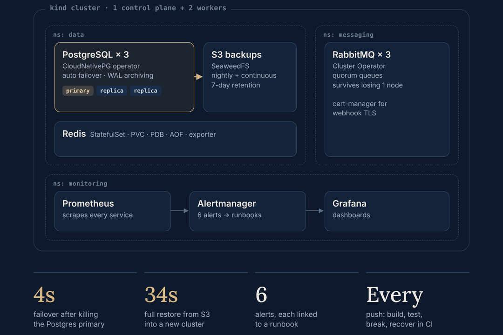
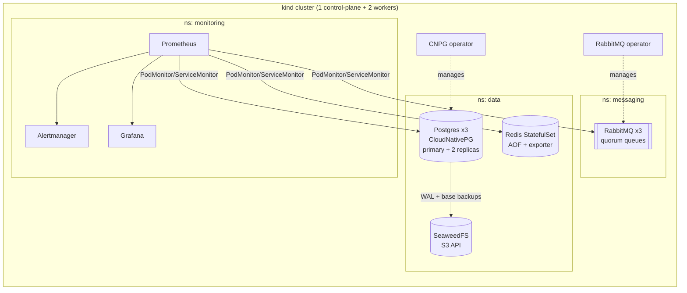

# k8s-stateful-platform

A production-style **stateful services platform on Kubernetes**: highly available PostgreSQL, a RabbitMQ cluster and Redis, with backups to S3-compatible storage (SeaweedFS), Prometheus alerting, Grafana dashboards, runbooks and tested failure recovery. It runs on a local 3-node kind cluster and in GitHub Actions.

> **Personal lab project.** I built it to go deeper on running databases and message queues on Kubernetes, on top of my day job running AWS/Kubernetes platforms. Everything here is reproducible: `make up && make test`.

 



## Architecture



| Component | How it runs | What it demonstrates |
|---|---|---|
| PostgreSQL 16 | CloudNativePG operator, 3 instances, pod anti-affinity | Streaming replication, automated failover, WAL archiving, nightly base backups, point-in-time restore |
| RabbitMQ | RabbitMQ Cluster Operator, 3 nodes (operator-pinned version) | Quorum queues (survive 1 node loss), memory watermark derived from the pod limit |
| Redis 7.4 | Hand-written StatefulSet (no operator) | volumeClaimTemplates, headless Service, probes, AOF persistence, PodDisruptionBudget, exporter sidecar |
| cert-manager | Helm | Issues the TLS certificates for the RabbitMQ operator's admission webhooks |
| SeaweedFS | Deployment + PVC | S3-compatible backup target (stands in for AWS S3) |
| Observability | kube-prometheus-stack | Alerts on replication lag, stale backups, queue backlog, memory alarm, Redis down/memory; each alert links a runbook |
| IaC / CI | Makefile, Terraform (kind + Helm), GitHub Actions | Lint (yamllint, shellcheck, kubeconform, terraform validate) + full e2e on every push |

## Quick start

Requires `docker`, `kind`, `kubectl`, `helm`.

```bash
make up        # ~10 min: kind cluster, monitoring, operators, data services
make test      # smoke test: write/read on every service, replication check
make drill     # backup -> restore into a new cluster -> verify; prints measured RTO
make chaos     # kill the Postgres primary and a RabbitMQ node; measures failover
make grafana   # http://localhost:3000 (admin / change-me-local-only)
make down
```

## Failure scenarios tested

| Scenario | Expected result | How tested | Measured in CI |
|---|---|---|---|
| Postgres primary pod deleted | Replica promoted automatically, writes resume | `scripts/failover-test.sh` | new primary in **4s** |
| Data loss / corruption | Restore from S3 backup into a new cluster, marker row verified | `scripts/pg-restore-drill.sh` | RTO **34s** (small lab dataset) |
| RabbitMQ node lost | Quorum queues stay available, node rejoins | `scripts/failover-test.sh` | node rejoined |
| Backups stop | `PostgresBackupStale` fires after 26h | `platform/alerts.yaml` | rule loaded |
| Consumers stop | `RabbitMQQueueBacklog` fires above 1000 ready messages | `platform/alerts.yaml` | rule loaded |

## Runbooks
- [Postgres backup stale / restore](runbooks/postgres-restore.md)
- [RabbitMQ queue backlog / memory alarm](runbooks/rabbitmq-queue-backlog.md)
- [Redis down / memory high](runbooks/redis-recovery.md)

## Design decisions
- **Operators for Postgres and RabbitMQ, a plain StatefulSet for Redis.** Operators encode failover and backup logic that's risky to hand-roll. Redis is written by hand to show the underlying primitives.
- **Restore into a new cluster, never in place.** You verify the restored data before switching traffic, and the broken cluster stays available for forensics.
- **Quorum queues by default.** Classic mirrored queues are deprecated, and quorum queues give Raft-based durability.
- **Alerts link to runbooks.** An alert with no next step just pages someone.

## What I'd change for production
- Use managed services where they fit (RDS/Aurora, Amazon MQ, ElastiCache Multi-AZ), or keep the operators on EKS with gp3 storage classes across 3 AZs.
- Move backups to real S3 with IRSA instead of static keys, and add bucket versioning and object lock.
- Keep secrets in External Secrets + AWS Secrets Manager rather than in-repo Secrets.
- Deploy with GitOps (Argo CD app-of-apps) instead of `make`.
- Migrate CNPG backups to the Barman Cloud Plugin (the in-tree `barmanObjectStore` is being deprecated).
- Redis: Sentinel or Redis Cluster for HA (this lab runs a single instance).

## Repo layout
```
kind/          cluster config
platform/      kube-prometheus-stack values, PrometheusRules
manifests/     namespaces, object-store (S3), postgres (CNPG), rabbitmq, redis
scripts/       smoke test, restore drill, failover test
runbooks/      on-call runbooks linked from alerts
terraform/     kind cluster + Helm releases as IaC
.github/       CI: lint + kind e2e
```
